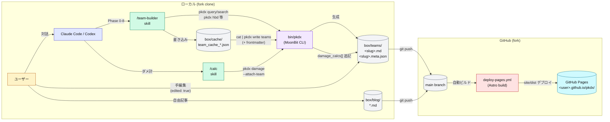

# pkdx

ポケモン対戦の構築支援ツールです。
Claude Code / Codex と対話しながらチームを組んだり、ポケモンの型を作ったり、ダメージ計算や対戦シミュレーションができます。

## できること

- **チームビルド**: 軸ポケモンを決めたら、タイプ補完・素早さ調整・メタ対策まで対話的にガイド。6体構築と3体選出パターンを提案する。チャンピオンズのバトルチームスクリーンショットから登録も可能
- **ダメージ計算**: 特性・持ち物・天候・テラスタル込みの乱数ダメージを計算。「確定2発」「乱数1発(12/16)」のような実戦的な確定数を出力する
- **育成シミュレーション**: 性格・特性・持ち物・技・努力値を対話的に設定し、Lv50実数値を算出。完成データはファイルに保存でき、チームビルドでも利用できる
- **耐久指数最適化**: H/B/D の努力値配分を最適化。HP条件（きのみ/オボン/たべのこし）・物理/特殊比重・top-N 候補の指定に対応し、「HBD 値が最大になる配分」を提示する
- **ポケモン検索**: 名前・タイプ・素早さ・覚えるわざなどの条件でポケモンを検索。技一覧やタイプ相性もすぐ引ける
- **バトルシミュレーション**: 登録済みのチーム2つを使って、選出から対戦結果までをシミュレーション。最適行動を取り続けた際の勝率を導出
- **構築記事・ブログ管理**: 登録したバトルチームデータを元に、構築ブログを公開できる。構築に紐づかないブログの作成も可能

## 対応バージョン

- 共有データ (`scarlet_violet` など): https://github.com/towakey/pokedex/
- Champions レギュレーション: https://github.com/projectpokemon/champout/ を入力ソースとして使用

## セットアップ

### A. データをクラウドに保存したい場合（GitHubアカウントあり）

GitHubアカウントがあれば、作成した構築・育成データをクラウドにバックアップでき、複数のPCで共有したり、過去のデータに戻すことができます。

1. GitHubの [pkdxtools/pkdx](https://github.com/pkdxtools/pkdx) ページ右上の「Fork」ボタンを押す
2. クローンしたリポジトリのURLをClaude Code / Codexに渡して「これ使いたい」
3. 以降は `/self-update` スキルで最新版に追従できる

### B. まず試してみたい場合（GitHubアカウントなし）

このリポジトリのURLをClaude Code / Codexに渡して「これ使いたい」でOK。データは手元のPCにのみ保存されます。
あとからGitHubアカウントを作成してクラウド保存に切り替えることも可能です。

## 使い方

Claude Code / Codex (CLI / デスクトップアプリどちらでも可) をこのリポジトリで開いて話しかけるだけ。

```
> ガブリアス軸で構築したい
> ガブリアスのげきりんでサーフゴーに何発？
> ガブリアスを育成したい
> ガブリアスの総合耐久を最適化したい
> 対戦シミュレーションをしたい
```

または、スキルを呼び出すことも可能

```sh
# 構築をはじめる
> /team-builder

# ダメージ計算をはじめる
> /calc

# 育成シミュレーションをはじめる
> /breed

# 対戦シミュレーションをはじめる
> /nash

# ブログの管理をはじめる
> /blog
```

作成したチーム・型は `./box` 配下に置かれる。手動で編集もできるし、Claude Code / Codex経由で閲覧・編集も可能。

### 構築をブログとして公開する（GitHub Pages）

GitHub にフォークしていれば、作成した構築記事とブログ記事を GitHub Pages に自動デプロイできる。

#### セットアップ (1 回だけ)

1. リポジトリの Settings → Pages → Source を **"GitHub Actions"** に切り替える
2. `main` に push すると、`.github/workflows/deploy-pages.yml` が自動で Astro サイトをビルドして公開する (URL は Actions ログに表示される)
3. 初回だけ手動でテストしたい場合は Actions タブから `Deploy Pages` → `Run workflow` をクリック

#### team-build → ブログ公開のデータフロー



#### 公開対象・編集ポリシー

カスタムドメイン: `site/public/CNAME` にドメイン名 1 行のファイルを置くと有効化。

公開を停止: Settings → Pages → Disable、または `box/site.config.json` の `enabled` を `false` にする。

サイト本体 (`site/` 配下) は upstream 管理なので直接編集は非推奨。カスタマイズは `box/site.config.json` と `site/public/` 経由で行う。

### CLI 単体でも使える

```bash
bin/pkdx query "ガブリアス"           # 種族値・特性を確認
bin/pkdx moves "ガブリアス"           # 覚える技を一覧
bin/pkdx search --type "ドラゴン" --min-speed 100  # 素早さ100以上のドラゴン
bin/pkdx damage "ガブリアス" "サーフゴー" "じしん"  # ダメージ計算
bin/pkdx hbd "カビゴン" --nature ずぶとい            # 耐久指数が最大になる努力値配分
bin/pkdx stat-calc "ガブリアス" --ev "0,252,0,0,4,252" --nature ようき  # 実数値計算
bin/pkdx type-chart "ほのお" "くさ"   # タイプ相性
bin/pkdx coverage "じめん,こおり"     # 攻撃範囲の確認
```

## 対応環境

macOS (Apple Silicon) / Linux (x86_64) / Windows (WSL2)

## ライセンス

MIT

## 対戦シミュレーションの対応範囲

`/nash` (選出最適化 / 最適戦略算出) が評価対象としているメカニクス。勝率・選出分布を読むときは ⚠️ / ❌ の影響を念頭に置いてください。

凡例: ✅ 対応済 / ⚠️ 部分対応 / ❌ 未対応

| カテゴリ | 要素 | 状態 | 備考 |
|---|---|:---:|---|
| フォーマット | 3v3 シングル | ✅ | 6匹 → 3匹選出 |
| フォーマット | ダブル (4v4) | ❌ | 未実装 |
| Nash 計算 | exact LP simplex solver | ✅ | LP simplex (Phase-1/Phase-2 + Bland's rule) で exact Nash 解。pure-saddle fast path で trivial degenerate ケースを sidestep |
| Nash 計算 | degenerate matrix fallback | ✅ | `pkdx select` と `pkdx nash solve` の両方で、simplex が iteration limit（`SimplexFailure`）で止まった場合、または有限行列の数値誤差で `InconsistentGame`（例: col LP unbounded）になった場合、fictitious_play (Robinson 1951) → multiplicative weights update (Freund & Schapire 1999) の順で iterative learner に自動 fallback、exploitability < tol (default 0.05 = 5% 勝率) で approximate Nash 採用。空行列・NaN/Inf は行列構築時にエラーのまま。simplex が成功したときの出力は変えない。出力 JSON の `nash_solver` field で経路 (`"simplex"` / `"fictitious_play"` / `"mwu"`) を確認可能。入力 JSON の `nash_solver_config.tol` / `iterations` で上書き可。pure-saddle は `@nash.solve_zero_sum` 内で解決され、そのときの `nash_solver` は `"simplex"` |
| Nash 計算 | 非正方の利得行列 (m×n) | ✅ | `pkdx nash solve` は 1×N / N×1 を含む矩形の零和利得行列を解く。simplex が成功すればその解を使い、iteration limit（`SimplexFailure`）または有限行列の数値誤差による `InconsistentGame` のときは fictitious play → MWU に fallback する。行の長さが揃わない入力と空行列はエラー。`pkdx nash graph` の matrix / characters は辺 `i → j` を同一ラベル集合上の有向辺として描くため正方のみ。team / opponent 形式は `(n+m)×(n+m)` に埋め込んでから描く |
| ダメージ計算 | 16段階乱数 / 一致 / 相性 / ランク / 急所 | ✅ | |
| ダメージ計算 | テラスタル | ✅ | |
| ダメージ計算 | 天候補正 | ✅ | 晴で炎 1.5x・水 0.5x、雨で水 1.5x・炎 0.5x、砂で岩タイプ防御側 SpD 1.5x、雪で氷タイプ防御側 Def 1.5x。`pkdx damage` 単体 / 状態遷移内 / 回復技 / EOT すべて現在天候を反映 |
| ダメージ計算 | フィールド補正 | ✅ | エレキ/グラス/サイコフィールドで対応タイプの技 1.3x (地上の攻撃側)、グラスフィールドで地震系 0.5x (地上の防御側)、ミストフィールドでドラゴン技 0.5x (地上の防御側)。`pkdx damage` 単体 / 状態遷移内 / EOT 全層で現在フィールドを反映 |
| 先手判定 | 優先度 (ねこだまし・しんそく等) + 実素早さ | ✅ | |
| 先手判定 | 素早さ同速 | ✅ | 0.5 / 0.5 分岐 |
| 命中率 | 確率ノードで分岐 | ✅ | 鬼火 85 / 電磁波 90 / ほうし 100 等 |
| ランク変化 | 自己強化 | ✅ | つるぎのまい / りゅうのまい / からをやぶる等 |
| ランク変化 | 相手ランク低下付与 | ✅ | あまえる / いやなおと / こわいかお / しっぽをふる / にらみつける等。瀕死ヒット時は付与スキップ |
| 状態異常 | まひ | ✅ | 行動不能 12.5% + S×1/2、電気タイプ免疫。ダメージ技の追加効果 (10% / 30% / 100%、m018) は命中後に付与 (りんぷん で防止、相手の HP が減らない命中では付かない。ばけのかわ の chip では付く) |
| 状態異常 | やけど | ✅ | 物理×1/2 + HP/16、炎タイプ免疫。ダメージ技の追加効果 (10% / 20% / 30% / 100%、m018) は命中後に付与。ねっとう / ねっさのだいち は相手の解凍後に付与 |
| 状態異常 | どく | ✅ | HP/8、鋼・毒タイプ免疫。ダメージ技の追加効果 (10% / 20% / 30% / 50% / 100%、m018) は命中後に付与 |
| 状態異常 | もうどく | ✅ | n/16 加算スリップ、交代でカウンタリセット。どくどくのキバ 50% (m018) |
| 状態異常 | ねむり | ✅ | Champions 規則 (help_syn.json:26333): 1 ターン目は確定で眠ったまま、2 ターン目は 1/3 で目覚めて行動 (命中判定あり)、3 ターン目は確定で目覚め。ねむる は 3 ターン目まで目覚めない (`RestSleep`)。交代中は残カウンタ据え置き。ねごと / いびき / はやおき は未対応 |
| 状態異常 | あくび | ✅ | 1 ターン予告 → 通常ねむり (Sleep(2)、上記規則)、交代で解除 |
| 状態異常 | こおり | ✅ | Champions 規則 (help_syn.json:26184): 凍結の試行ごとに 25% で解凍して行動、3 ターン目は確定解凍。炎タイプのダメージ技で解凍、ねっとう / ねっさのだいち は相手も解凍、フレアドライブ 等の解凍技は使用者を解凍。こおりタイプ・はれ・マグマのよろい は凍らない。付与源は技の追加効果 (れいとうビーム 等 10%、m017)。トライアタック は未対応 |
| 状態異常 | こんらん / メロメロ / バインド | ❌ | |
| 状態異常 | フィールド連動 | ⚠️ | 技由来の状態異常では、ミストフィールドが地上ポケモンへの実装済み状態異常をすべて防止し、エレキフィールドがねむり・あくび予告を防止。接触特性・接触持ち物による状態異常と、へんげんじざい / リベロで変化したタイプの地上判定は未対応 |
| 継続効果 | やどりぎのタネ | ✅ | 付与 / 1/8 EOT 吸収 / Magic Guard で tick 無効化 / Liquid Ooze (ヘドロえき) で反転 damage / 交代で剥がし / くさタイプ免疫 (mega 反映後 type) |
| 継続効果 | グラスフィールド回復 | ✅ | グラスフィールド中、地上ポケモンが EOT で max HP / 16 回復 (たべのこしの直後、やどりぎのタネの直前) |
| 同ターン内順序 | 先行付与状態を後攻行動前に反映 | ✅ | やけどで後攻物理半減 / ねむりで後攻行動スキップ |
| 交代 | 基本交代 + ランクリセット | ✅ | |
| 交代 | いかく (Intimidate) | ✅ | 登場時 (先発/交代/死に出し) に相手 Atk -1。ばんけん +1 / ミラーアーマー 反射 / びびり A-1&S+1 / あまのじゃく 反転 / 無効化特性 8 種 no-op。メガ後実効特性で判定・DP/MC parity |
| 交代 | その他の交代関連効果 | ❌ | プレッシャー / 滅びのうた / おいうち |
| メガ進化 | ステ・タイプ・特性切替 | ✅ | 各サイド 1 回 |
| 攻撃技 | 連続技 (multi-hit) | ✅ | Random 2-5 hit (タネマシンガン等) / トリプル系 per-hit power 増加 (トリプルアクセル等) / ネズミざん 1-10 hit (per-hit 90% 幾何) / スキルリンク 5 固定 / おやこあい 2-hit。各 hit を確率分岐ノードで展開 |
| 攻撃技 | 攻撃技由来の副次状態異常 | ⚠️ | こおり (m017: れいとうビーム 等 5 技 10%) と やけど / まひ / どく / もうどく (m018: 33 技、本文の確率) を move_meta に投入。DP / MC は命中ごとに独立に抽選し (連続技は hit ごと)、相手の HP が減らない命中 (タイプ免疫・吸収・瀕死) には付かない。ばけのかわ の chip では付く (Showdown fallback)。ちからずく の使用者は追加効果を失う。未対応: トライアタック / フェイタルクロー (複数状態異常)、しっとのほのお (条件付き)、くちばしキャノン、ねむり付与の副次効果。**DB → payoff 接続済み**: `pkdx moves` の JSON が `status_effect` (`{"kind":"やけど","chance":10}`) を出し、`pkdx select` がその値を読む。効果の無い技はキーを省略する |
| 攻撃技 | ひるみ (追加効果) | ⚠️ | 本文の「N% chance of making the target flinch」を move_meta.flinch_chance に投入 (m019: 18 技 + 表記違い 1 件)。ねこだまし は m020 (初行動ゲートと flinch 100)、はやてがえし は m021 (相手の選択が priority > 0 のときだけ成功。priority 3 と flinch 100)。m019 はどちらも入れない。先攻の命中で相手が生存すると命中ごとに独立に抽選し、成立した相手は同ターンの後攻の行動を失う (持ち越さない)。せいしんりょく は受けない、りんぷん / ちからずく は既存ゲート、ふくつのこころ は行動を止められた時だけ素早さ +1。未対応: であいがしら、いびき の使用条件 (ねむり中のみ、ひるみ率だけ投入)、ドラゴンダイブ のミニマイズ威力、におい (特性の 10% ひるみ)、てんのめぐみ。おやこあい の 2 命中目は DP だけ抽選に入る (MC は 1 回)。**DB → payoff 接続済み**: `pkdx moves` の JSON が `flinch_chance` を出し (0 の技は省略)、`pkdx select` がその値を読む |
| 攻撃技 | 反動技 | ✅ | ブレイブバード 1/3 / すてみタックル 1/4 / はめつのひかり 1/2 等 12 種。**DB → payoff 接続済み**: `pkdx moves` の JSON が `recoil_num` / `recoil_den` を出し (反動なしの技は省略)、`pkdx select` がそれを読む |
| 攻撃技 | 自滅技 | ✅ | じばく / だいばくはつ。**DB → payoff 接続済み**: `pkdx moves` の JSON が `self_ko` を出し、`pkdx select` がそれを読む |
| 攻撃技 | 最大HP反動技 | ✅ | てっていこうせん: 命中・外れ・免疫のいずれでも使用者が最大 HP の 1/2 (切り上げ) を失う。マジックガードは無効 |
| 攻撃技 | 反動硬直 (次ターン完全スキップ) | ✅ | はかいこうせん / ギガインパクト / ブラストバーン / ハイドロカノン / ハードプラント。技選択・交代ともに不可 |
| 攻撃技 | 優先度技 (フィールド連動) | ✅ | サイコフィールド中、地上ポケモンへの優先度 > 0 の技を無効化 (技は使用されるが効果が出ない、しんそく等の単体技対象) |
| 攻撃技 | 2 ターン溜め | ❌ | ソラビ / ロケットずつき / ダイビング等 |
| 攻撃技 | タイプ相性上書き (フリーズドライ) | ✅ | みずタイプに 2 倍。複合タイプ・抜群判定・半減木の実を含め、SwitchingGame / MC の共通ダメージ計算に反映 |
| 攻撃技 | タイプ相性上書き (フライングプレス) | ✅ | かくとう×ひこうの積 (Showdown `onEffectiveness`)。抜群判定・半減実は複合後 (ヨプのみは発動、バコウのみは技タイプ不一致で不発)。STAB とタイプ強化はかくとうのみ。解決後の技タイプにもひこうを乗算。ちいさくなるの威力 2 倍・必中は未モデル |
| 特性 | 接触特性 (defender 側 proc) | ✅ | せいでんき / ほのおのからだ / どくしゅ (30% 各) / ほうし (11/10/9% 毒/まひ/眠) を per-hit で抽選 |
| 特性 | 多段補正 | ✅ | スキルリンク (固定 5 hit) / おやこあい (2 hit) / じきゅうりょく (per-hit B+1) |
| 特性 | スキン特性 | ✅ | フェアリースキン / エレキスキン等。技タイプ書換 + ×1.2 + 半減木の実判定に反映 |
| 特性 | こおり免疫 | ✅ | マグマのよろい (凍らない) / りんぷん (ダメージ技の追加効果を防ぐ: こおり / やけど / まひ / どく / もうどく)。リーフガード / ぜったいねむり は未モデル |
| 特性 | ちからずく (Sheer Force) | ⚠️ | 使用者の追加効果 (状態異常) を失う。威力 1.3 倍は **全技** に掛かる (本文は追加効果のある技のみ。既存の挙動で未修正)。能力変化やひるみなど、状態異常以外の追加効果は元々未モデル |
| 特性 | 状態異常免疫 (じゅうなん / めんえき / ねつこうかん / すいほう / きよめのしお / リーフガード / フラワーベール 等) | ❌ | 技の状態異常と追加効果の両方で未モデル (ふみん / やるき / スイートベール の眠り免疫のみ既存)。シンクロ (反射) も未モデル |
| 特性 | 回復・状態異常干渉 | ✅ | ふみん / やるき / スイートベール (Sleep / あくび 免疫 + Rest 失敗) / マジックガード (やどりぎ tick 無効化) / ヘドロえき (Drain + やどりぎ 反転) / ぼうじん / すなかき / すながくれ / すなのちから (Sand chip 免疫) |
| 特性 | あまのじゃく (Contrary) | ✅ | 技の能力変化 (自己積み・相手ダウン) を反転。からをやぶる/オーバーヒート/インファイト 等・いかく反転込み。DP/MC parity |
| 特性 | ばけのかわ (Disguise) | ✅ | 初撃ダメージ無効 + chip(最大HP/8) で剥がれ。1戦闘1回・交代非回復・連続技初段のみ・反動/ドレインは実ダメージ基準。DP/MC parity |
| 特性 | へんげんじざい / リベロ | ⚠️ | 場に出て最初に成功した固定タイプ技のタイプへ変化し、その後の攻撃側 STAB・防御側タイプ相性に反映。交代で再発動可能、テラスタル中は発動しない。命中失敗時の発動と、ウェザーボール等の動的な実効タイプへの変化は未対応 |
| 特性 | 再生力 (Regenerator) | ✅ | 交代で場を離れるとき最大HPの1/3（切り捨て）を回復。最大HPは超えない。ひんしでは不発。交代先には効果なし。メガ後の実効特性で判定。DP/MC parity |
| 特性 | まけんき / かちき (Defiant / Competitive) | ⚠️ | 相手由来の能力ダウン（いかく / stat_effects 表収録の相手ダウン技: あまえる・いやなおと・こわいかお・しっぽをふる・にらみつける・なきごえ・くすぐる・なみだめ）で、実際に下がった能力ごとに 1 回、まけんき = 攻撃 +2 / かちき = 特攻 +2（上限 +6）。くすぐる・なみだめ は両方下がれば 2 回反応する（同じ能力への重複エントリは 1 回）。ダウンの判定は技の開始時点のランクで行い、開始時点で -6 の能力は下がらず反応もしない（Showdown 準拠）。自分の技の自己ダウン・ブロックされたダウンは不発。所持者のランクは ±6 で追跡。DP/MC parity。未対応: 確率付き追加効果による相手ダウン（表に無い技）、みがわり・しろいきり等による阻止、ミラーアーマーによる技由来ダウンの反射（反射を受けた使用者側の反応を含む） |
| 特性 | 未対応のその他特性 | ❌ | トレース / じゅうなん / かたやぶり |
| 持ち物 | 半減木の実 | ✅ | オッカのみ等 17 種 + ホズのみ。効果ばつぐん時 (ホズのみは Normal neutral) に半減 + 1 回消費 |
| 持ち物 | きあいのタスキ | ✅ | 満タン → KO 級被弾を 1 HP rescue。multi-hit 集計 KO は救済しない |
| 持ち物 | 回復木の実 | ⚠️ | オボンのみ (1/2 HP 閾値跨ぎ → max HP/4 回復) / フィラのみ (→ max HP/3 回復) に対応。他の混乱実 (ウイ / マゴ等) と混乱実の混乱副作用は未反映 |
| 持ち物 | 接触持ち物 | ✅ | とびだすハバネロ (100% やけど) / とびだすなかみ (100% まひ) を per-hit で抽選 |
| 持ち物 | ダメージ補正系 | ⚠️ | こだわりハチマキ / メガネ / いのちのたま / たつじんのおび等は計算に反映。拘りロック / とつげきチョッキロック / たべのこし等の挙動は未反映。しろいハーブは負のランクを全て 0 に戻して消費する挙動を pkdx select の DP / MC に反映（なげつける による投擲は未対応） |
| 変化技 | 壁 / 設置技 / 守る | ❌ | |
| 変化技 | 天候設定技 | ✅ | にほんばれ / あまごい / すなあらし / ゆきげしき、5T 固定。**DB → payoff 接続済み**: `pkdx moves` の JSON が `weather_set` (sun / rain / sand / snow) を出し、`pkdx select` がそれを読む。天候石 (あついいわ等) による持続延長は未対応。Sand 中は chip damage tick (max/16) |
| 変化技 | フィールド設定技 | ✅ | エレキフィールド / グラスフィールド / ミストフィールド / サイコフィールド、5T 固定。**DB → payoff 接続済み**: `pkdx moves` の JSON が `field_set` (electric / grassy / misty / psychic) を出し、`pkdx select` がそれを読む。グランドコート (持続延長) は未対応 |
| 変化技 | 回復技 | ✅ | FixedFraction (じこさいせい / なまける / はねやすめ) / WeatherDependent (つきのひかり / あさのひざし / シンセシス、晴=2/3 雨砂雪=1/4 none=1/2) / Drain (ギガドレイン等、ヘドロえき反転) / Rest (Sleep 免疫 ability で失敗 + 満タン時 failure) / PainSplit (いたみわけ) / Wish (ねがいごと、slot bound、T+1 EOT 発動)。**DB → payoff 接続済み**: `pkdx moves` の JSON が `heal_kind` と分数キー (weather は晴れ / 雨・雪・砂の分数も) を出し、`pkdx select` がそれを読む |
| 特殊システム | Z 技 / ダイマックス | ❌ | 未実装 |
